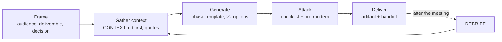

# Solution Architect Copilot

An agent skill that turns an AI assistant (Claude Code, Claude.ai, or any agent that reads markdown instructions) into a working copilot for **Solution Consultants and Solution Architects**: presales, discovery, design, estimation, proposals and customer communication.

The architect stays the decision-maker. The AI does the heavy lifting: reading, synthesis, drafts, calculations, diagrams. It also attacks the ideas before the customer does. Every answer comes back as a reusable artifact plus a **handoff** telling you what to trust, what to check and what to do next.

## Why this skill

Used without guidance, a general-purpose assistant tends to:

- answer with "best practices" instead of trade-offs;
- invent prices and service limits;
- do arithmetic in its head;
- agree with whatever you propose;
- bury what matters in long prose.

This skill turns the countermeasures into rules the agent follows on every request:

| Problem | What the skill enforces |
|---|---|
| Hallucinated prices, limits, features | Every product fact has a source and date, or is marked `[TO VERIFY]` with a link to check it |
| Wrong numbers | Sizing, TCO and ROI are computed in code or spreadsheets with parameters at the top |
| Sycophancy | Your proposals are treated as hypotheses; the strongest counter-argument comes first |
| Missing context | At most 5 targeted questions, or explicit `ASSUMPTION:` markers if you want to move fast |
| "It depends" | Rewritten as "if X → A, otherwise → B" |
| Long answers you can't act on | A one-screen handoff at the top of every reply |
| Losing the thread across sessions | A per-opportunity `CONTEXT.md`, read first and updated last |

## What's inside

```
solution-architect-copilot/
└── SKILL.md      # the skill: rules, working loop, handoff, 14 phases, guide, checklists
```

`SKILL.md` has two parts:

1. **Instructions for the AI**: 9 always-on rules, a 5-step working loop, the handoff format and 14 phase playbooks with templates.
2. **A guide for the architect**: ways of working with AI, prompting techniques, ready-made prompts, confidentiality and governance, known limits with countermeasures.

## Installation

### Claude Code

Personal skill, available in every project:

```bash
git clone git@github.com:b-iurea/solution-architect-copilot.git
mkdir -p ~/.claude/skills
cp -r solution-architect-copilot/solution-architect-copilot ~/.claude/skills/
```

Project skill, shared with your team through the repo: copy the folder into `.claude/skills/` at the project root instead.

Claude loads the skill on its own when the request matches its description (discovery, ADR, TCO, RFP, ...). You can also invoke it explicitly with `/solution-architect-copilot`.

### Claude.ai / Claude Desktop

Zip the `solution-architect-copilot/` folder and upload it under **Settings → Capabilities → Skills**.

### Other agents (pi, Codex, Cursor, custom agents)

`SKILL.md` is plain markdown. Point your agent at it, for example with a line in `AGENTS.md` such as "For presales and solution architecture work, follow `path/to/SKILL.md`", or paste it into the system prompt or project instructions.

## Usage

Talk to the agent normally, or open a phase directly with its keyword:

| Keyword | Phase | You get |
|---|---|---|
| `RESEARCH` | Account research | 1-page brief with sourced pain hypotheses and discovery questions |
| `DISCOVERY` | Discovery | Questions by role (MEDDPICC/SPICED); from a transcript: structured notes with quotes, gaps, follow-up email |
| `NFR` | Requirements | Measurable NFRs as quality-attribute scenarios |
| `DESIGN` | Design | Options matrix with weighted criteria, steelman of the alternatives, recommendation |
| `ADR` | Decisions | Architecture Decision Record (Nygard/MADR) |
| `DIAGRAM` | Diagrams | Mermaid or Structurizr DSL, rendered and validated |
| `REVIEW` | Review | Well-Architected + STRIDE + OWASP LLM findings table |
| `ESTIMATE` | Estimates | WBS with three-point estimates, TCO model in code, ROI |
| `RFP` | Bids | Compliance matrix, proposal structure, SOW risky-wording sweep |
| `DEMO` | Demo/PoC | Pain-driven storyline, objection prep, PoC success criteria |
| `EXEC` | Executive | One-pager, slide titles that state conclusions (Minto/SCQA) |
| `GRILL` | Stress test | Pre-mortem, hostile reviewer panel (CFO, CISO, ops, procurement) |
| `DEBRIEF` | After a meeting | Updated context, closed assumptions, delta on the deliverable |
| `COACH` | Your growth | Guided questions, then the principles behind the differences |

Examples:

```
DISCOVERY on this transcript: <paste>
DESIGN: the customer wants to centralize all syslogs on AWS, managed services only, 2.2 TB/day
GRILL the proposal in deliverable/solution.md
DEBRIEF: the customer said retention must be 24 months and they already have Splunk
```

### The working loop



Each step has an explicit completion criterion. For example, "Gather context" is done only when every requirement has a source quote or is marked `ASSUMPTION`.

### The handoff

Every reply opens with a block like this, which fits on one screen:

```markdown
**In 30 seconds**: S3 as the archive + CloudWatch for the critical 10% only, ~8.5 k$/month
  vs ~37 k$ all-in CloudWatch. We need 5 answers from the customer, then a 3-week PoC.
**Confidence**: medium. To raise it: measured volume and confirmed use case.
**Choices made on your behalf**: matrix weights (cost 30%), 12-month retention, 3x peak.
**Assumptions that flip everything**: full-text search on everything is a must → OpenSearch (+7 k$/month).
**Read first**: deliverable/solution.md §Technical points (Firehose quotas).
**Not verified**: prices in estimates/tco.py → AWS Pricing Calculator for the target region.
**Your move**: send the email in deliverable/meeting-kit.md; request a Firehose quota increase.
```

When the deliverable is going to a customer, the agent also prepares a **meeting kit**: a ready-to-send cover email, a 2-minute talk track and the most likely objections, each with answer and evidence.

### Recommended folder per opportunity

Agentic mode works best with one folder per opportunity, under git:

```
customers/<customer>/<opportunity>/
  CONTEXT.md     # goals, stakeholders, constraints, decisions, open questions, interaction log
  input/         # RFPs, transcripts, customer documents
  adr/
  diagrams/      # .mmd / .dsl
  estimates/     # TCO/effort scripts or spreadsheets
  deliverable/
```

`CONTEXT.md` is the opportunity's single source of truth. The agent reads it at the start of every session and updates it at the end, so the next session starts where the last one stopped.

## Confidentiality

Customer material is sensitive. The skill makes the agent flag personal data, credentials, internal hostnames and NDA-covered content, and propose anonymized versions. The guide section of `SKILL.md` covers the rest:

- enterprise plans with no training on your data and zero data retention where available;
- reading the customer's NDA clauses before uploading anything;
- one workspace per customer;
- local models for the most sensitive material.

## Improving the skill

`SKILL.md` ends with a **Lessons from the field** section. After each real use, add one line: what worked, what didn't, which rule to change. Rules born from real failures beat rules written in advance. Issues and pull requests with field-tested improvements are welcome.

## Research behind it

The rules are grounded in published guidance and studies. Highlights:

- **Anthropic's prompting best practices**: long documents first, XML tags, extracting quotes first, examples. [Link](https://platform.claude.com/en/docs/build-with-claude/prompt-engineering/claude-prompting-best-practices)
- **UK AISI, "Ask Don't Tell"**: framing a claim as a question reduces sycophancy more than asking the model not to be sycophantic. [Link](https://arxiv.org/abs/2602.23971)
- **Çalikli & Alhamed (FSE 2025)**: LLM effort estimates anchor on numbers present in the request. [Link](https://conf.researchr.org/details/fse-2025/fse-2025-research-papers/104/Impact-of-Request-Formats-on-Effort-Estimation-Are-LLMs-Different-than-Humans-)
- **ICSA 2024, IEEE Software 2026**: LLMs suggest relevant design options but lack context and are inconsistent, so the human decides. [Link 1](https://arxiv.org/abs/2403.01709), [Link 2](https://researchdiscovery.drexel.edu/esploro/outputs/journalArticle/LLMs-as-Assistants-in-Software-Architecture/991022164542204721)
- **AWS on GenAI-assisted Well-Architected reviews**: human-in-the-loop validation remains crucial. [Link](https://aws.amazon.com/blogs/machine-learning/accelerate-aws-well-architected-reviews-with-generative-ai)

The full source list is at the bottom of [`SKILL.md`](solution-architect-copilot/SKILL.md).
